# joyboy

**Ask your AI coding agent for a video. Get a finished MP4.**

joyboy is a skill that lets an agent such as Claude Code make complete videos entirely in code: promos, teasers, logo reveals, explainers, app demos, website tours, data stories, reels and short films, with generated music, matching sound effects and narration. No video model, no editor, no stock footage.

[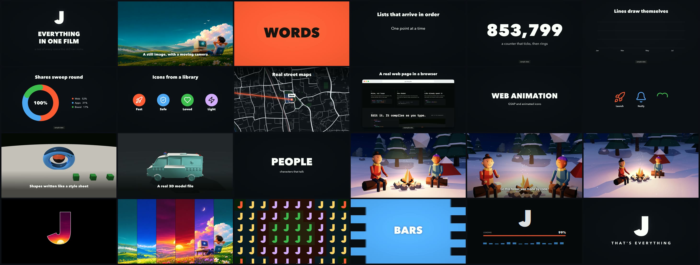](examples/showreel.mp4)

**[Watch the showreel](examples/showreel.mp4)** (2 min 20 s, with sound). Every scene in it was made by the skill from one short script, [`examples/showreel.py`](examples/showreel.py).

## Examples

Each preview below is a silent clip. Click it to open the full version with sound.

| | |
|---|---|
| [](examples/01-pictures-and-type.mp4)<br>**Pictures and type.** Camera moves over still images, kinetic words, quotes and lists that size themselves to fit. | [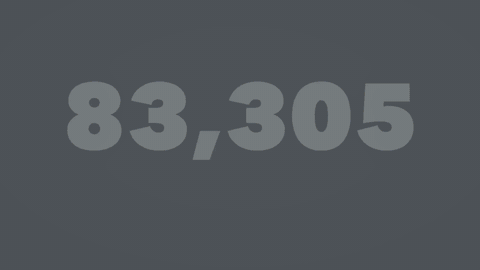](examples/02-data-icons-maps.mp4)<br>**Data, icons and maps.** Counters, charts that draw themselves, library icons, and real street maps from OpenStreetMap. |
| [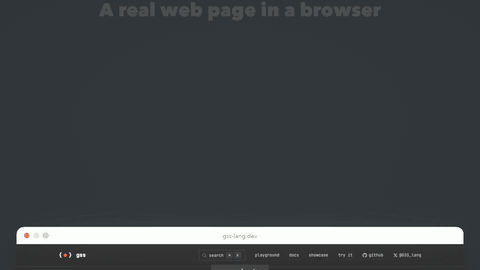](examples/03-real-web-pages.mp4)<br>**Real web pages.** A live page captured and shown scrolling in a browser window and a phone frame. | [](examples/04-web-animation.mp4)<br>**Web animation.** GSAP scenes and animated icons, captured frame by frame. |
| [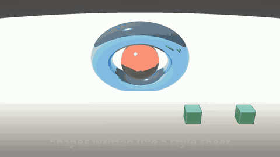](examples/05-3d-shapes-and-models.mp4)<br>**3D shapes and models.** Glass and metal shapes written like a style sheet, and real 3D model files on a turntable. | [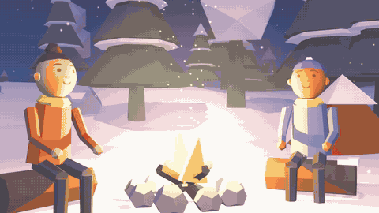](examples/06-people-and-worlds.mp4)<br>**People and worlds.** Illustrated characters that talk with lip sync, in a 3D place with weather and film cameras. |
| [](examples/07-reel-effects.mp4)<br>**Reel effects.** Logo window, slices, carousel, grid, tunnel, shape wipes and a loader, cut on the beat. | |

All content in the examples is sample content.

## 24 kinds of video, one brand

The same skill, given one brand kit, made each of these in a single pass: a product demo, a story, an explainer, a teaser, a data story, a website tour, an app showcase, an ad, an invitation and more. Each preview is a silent clip; click it to watch the full video with sound. Each is 15 to 30 seconds.

| | | |
|:-:|:-:|:-:|
| <a href="examples/kinds/announcement.mp4"></a><br><sub>Announcement</sub> | <a href="examples/kinds/app-showcase.mp4">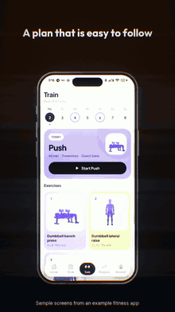</a><br><sub>App showcase</sub> | <a href="examples/kinds/brand-introduction.mp4">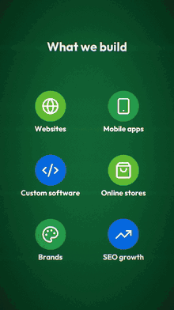</a><br><sub>Brand introduction</sub> |
| <a href="examples/kinds/community.mp4">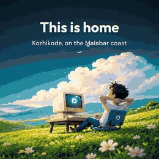</a><br><sub>Community</sub> | <a href="examples/kinds/comparison.mp4">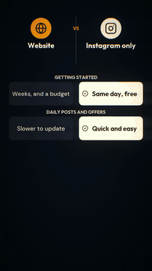</a><br><sub>Comparison</sub> | <a href="examples/kinds/customer-story.mp4"></a><br><sub>Customer story</sub> |
| <a href="examples/kinds/data-story.mp4">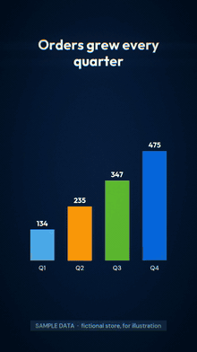</a><br><sub>Data story</sub> | <a href="examples/kinds/educational-short.mp4">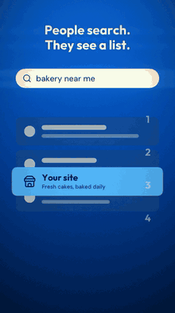</a><br><sub>Educational short</sub> | <a href="examples/kinds/event-invitation.mp4">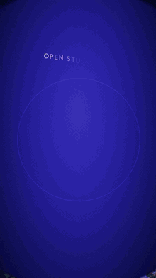</a><br><sub>Event invitation</sub> |
| <a href="examples/kinds/explainer.mp4">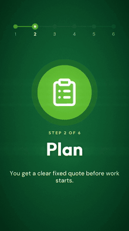</a><br><sub>Explainer</sub> | <a href="examples/kinds/feature-spotlight.mp4"></a><br><sub>Feature spotlight</sub> | <a href="examples/kinds/kinetic-type.mp4"></a><br><sub>Kinetic type</sub> |
| <a href="examples/kinds/launch-teaser.mp4">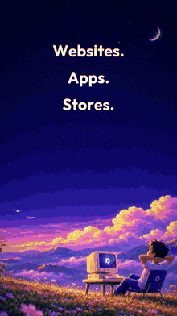</a><br><sub>Launch teaser</sub> | <a href="examples/kinds/offer-spotlight.mp4"></a><br><sub>Offer spotlight</sub> | <a href="examples/kinds/onboarding.mp4">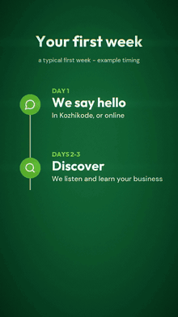</a><br><sub>Onboarding</sub> |
| <a href="examples/kinds/portfolio.mp4">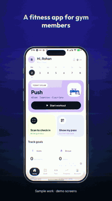</a><br><sub>Portfolio</sub> | <a href="examples/kinds/product-demo.mp4">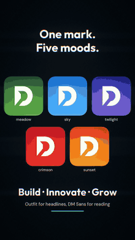</a><br><sub>Product demo</sub> | <a href="examples/kinds/recruitment.mp4"></a><br><sub>Recruitment</sub> |
| <a href="examples/kinds/service-explainer.mp4"></a><br><sub>Service explainer</sub> | <a href="examples/kinds/social-ad.mp4">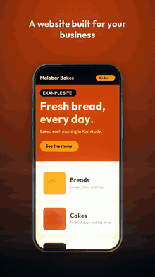</a><br><sub>Social ad</sub> | <a href="examples/kinds/storytelling.mp4">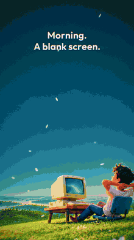</a><br><sub>Storytelling</sub> |
| <a href="examples/kinds/tutorial.mp4">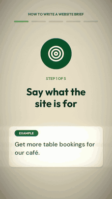</a><br><sub>Tutorial</sub> | <a href="examples/kinds/visual-mood-film.mp4"></a><br><sub>Visual mood film</sub> | <a href="examples/kinds/website-tour.mp4">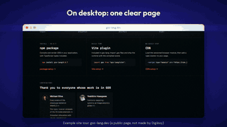</a><br><sub>Website tour</sub> |

These were made as tests for a studio brand called Digiboy. The offers, events, customers and numbers in them are invented examples and are marked on screen; the app screens are sample screens.

## How it works

You describe the video in plain words. The agent asks a few simple questions, then writes a short script of scenes like this and renders it on your computer:

```python
film = Film("spring-sale", size="portrait", mood="upbeat", palette=["#101018", "#ff5a36", "#ffd166"])
film.intro("SPRING SALE", sub="this weekend only", logo="assets/logo.png")
film.image("assets/shop.jpg", text="Everything in store", move="push")
film.stat("40%", "off all shoes")
film.map("12 Market Street, Springfield", pins=[("We are here", "12 Market Street, Springfield")])
film.outro("OPEN 9 TO 9", sub="12 Market Street", logo="assets/logo.png")
film.render()
```

- **Every frame is computed**, so the result is exact and repeatable.
- **Changes are small edits.** "Remove that scene", "make it wide for YouTube" or "change the voice" is a line or two, not a new video.
- **Sound is part of the scene.** Scene lengths snap to the music's beat, and each scene carries the sound of what it shows: ticks for a counter, a scribble for a line being drawn, a pop for a map pin.
- **Each video keeps its own folder** with the finished file, the code that made it and a readable script.

## Install

Pick the line for your tool, then start a new session.

**Claude Code, as a plugin** (the skill appears as `/joyboy:joyboy`):

```bash
claude plugin marketplace add ikku47/joyboy
```

```bash
claude plugin install joyboy@joyboy
```

**Claude Code, Codex and other agents, with one command** (installs for every tool it finds on your machine):

```bash
curl -fsSL https://raw.githubusercontent.com/ikku47/joyboy/main/install.sh | bash
```

Read [`install.sh`](install.sh) first if you prefer. It only copies the skill folder into each tool's skills folder, and it keeps a backup of any copy already there. To choose where it goes, clone the repository and run `bash install.sh --claude`, `--codex`, `--agents`, `--all` or `--dir <folder>`.

**Any agent that reads the Agent Skills format:**

```bash
npx skills add ikku47/joyboy
```

**Claude desktop and web apps:** download `joyboy.skill` from the [Releases](https://github.com/ikku47/joyboy/releases) page, open it in Claude and choose Save skill.

What changed in each version is in the [changelog](CHANGELOG.md).

**By hand:** copy the `skills/joyboy` folder into your tool's skills folder (for Claude Code, `~/.claude/skills/joyboy`).

## Use

Ask for a video in your own words:

- "Make a 20 second teaser for my coffee shop opening on Friday."
- "Turn these five screenshots into an app demo for Instagram."
- "Explain how our booking works in a one minute video with a voice-over."
- "Make a short film: two friends by a campfire in a snowy forest, talking about old phones."

The agent asks up to ten short questions (what it is for, where it will be shown, what you have, what it should say, language, style, length, sound, how it opens and closes, anything to avoid) and skips any you have already answered. Say "you decide" to skip them all.

The first video sets up a workspace in `~/joyboy` and installs what it needs once. Every later video reuses it.

## What it can make

| Area | What you get |
|---|---|
| Pictures | Camera moves over still images: push, pull, pan, tilt, parallax |
| Type | Titles, kinetic words, quotes, bullet lists, letter-by-letter text, all sized to fit |
| Data | Counters, bar and column charts, line charts, donuts, heat maps |
| Places | Real street maps from OpenStreetMap data, with pins and routes |
| Screens | Real web pages captured and shown in a phone frame or a browser window |
| Website tours | Any public website downloaded once, then its own elements lit, labelled, lifted and clicked for tours and explainers |
| Icons | Library icons (about 30 sets), still or animated |
| Web animation | GSAP scenes captured frame by frame |
| 3D | Glass and metal shapes (GSS), real model files (67.js), and procedural worlds with people (three.js) |
| People | Illustrated characters that speak with lip sync |
| Reel effects | Logo-locked fast cuts, logo window, slices, carousel, grid, tunnel, loader, shape wipes |
| Sound | Music in five moods, a sound for what each scene shows, ambience, narration in many languages |
| Shapes | Tall, wide, square and 4:5 from the same script |

## What it needs

| Need | For |
|---|---|
| Python 3 and ffmpeg | Everything. The Python packages are installed into the workspace by the skill |
| Node and a Chrome-family browser | Icons, GSAP scenes, captured web pages, characters, worlds and 3D |
| A GPU the browser can use | Worlds and 3D scenes |
| Internet, the first time | One-time installs, voice downloads and map data |

Without Node and Chrome the rest still works: charts, maps, type, images, phones, logos, music and narration are pure Python. If [bun](https://bun.sh) is installed it is used for the JavaScript packages, which makes that step much faster.

## Honest limits

- **Tested on macOS with Apple Silicon only.** Linux and Windows are untested; default fonts, the system-voice fallback and browser paths are the likely trouble spots.
- **The agent cannot watch or hear the result.** It checks still frames and printed sound levels, then tells you what it could not verify. Watch the video before you publish it.
- **Narration** uses Piper, which is free and runs on your machine. ElevenLabs is used only if you provide your own key. Lip sync follows loudness, not exact mouth shapes.
- **3D models** must be supplied as single `.glb` files; the skill shows models, it does not create them.
- **Map routes** are straight lines between points, not driving directions.
- **Other agents:** the instructions were written for Claude Code. They name a few Claude tools (a question tool, file sending, subagents) and say what to do when those are missing, but other agents have had little testing.

## Third-party pieces

The skill downloads these into your workspace when they are first needed; none are included in this repository. Each has its own licence, which applies to your use of it.

| Piece | Used for | Licence note |
|---|---|---|
| OpenCV, NumPy, Pillow, SciPy | Drawing and sound | Open source |
| ffmpeg | Encoding | You install it yourself |
| Piper TTS and its voices | Narration | Voices have their own licences |
| GSAP | Web animation | Free to use under GSAP's standard licence |
| three.js, 67.js, gss-lang | 3D | MIT, MIT, Apache 2.0 |
| react-icons, lucide-static | Icons | Each icon set has its own licence |
| DiceBear | Characters | Some styles need a credit (CC BY 4.0) |
| OpenStreetMap data | Maps | Credit "(c) OpenStreetMap contributors" is added on screen |

## What is in the repository

```
skills/joyboy/        the skill: SKILL.md, scripts, references
examples/             the showreel, its chapters and script, and 24 kinds of video in examples/kinds
.claude-plugin/       plugin and marketplace files for Claude Code
install.sh            installer for Claude Code, Codex and other agents
```

The artwork, model and captured page used in the examples are not included, so `examples/showreel.py` is for reading, not for running as it is.

## Licence

MIT. See [LICENSE](LICENSE). The example videos show sample content; the painted artwork in them belongs to its owner and is not covered by the MIT licence.
